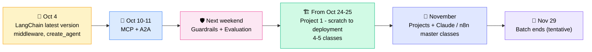
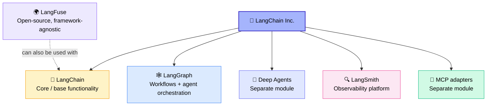
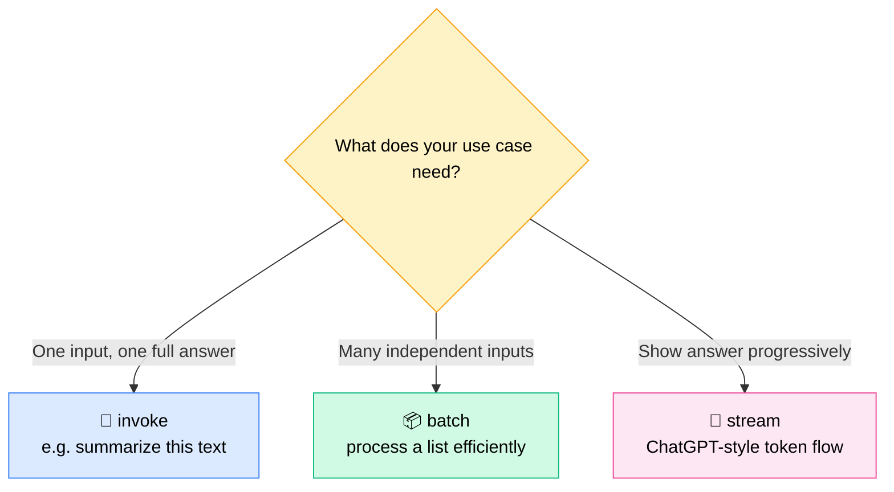
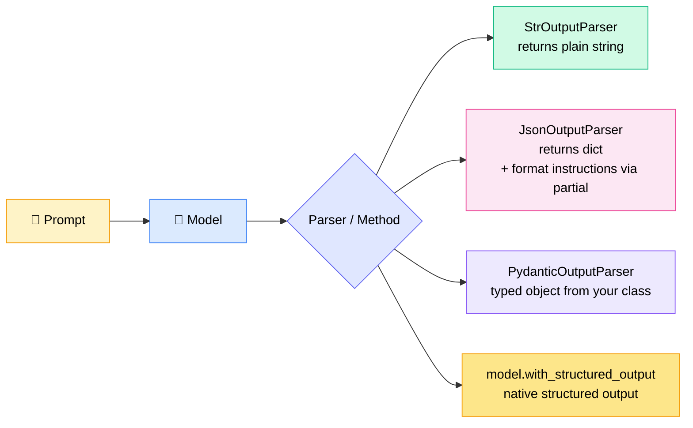
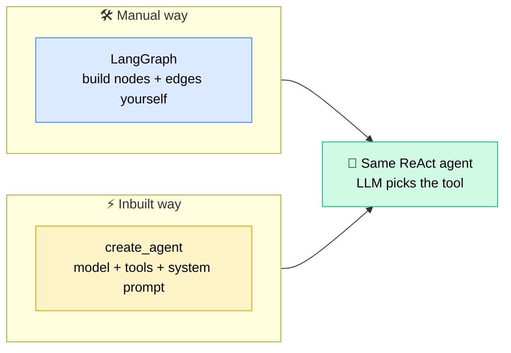
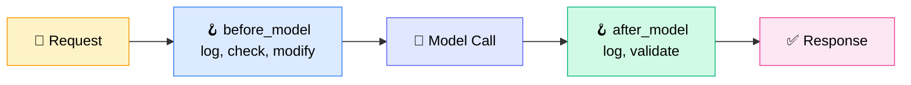

# 🧱 LangChain (Latest Version) — Ecosystem, Core Concepts & Middleware
### 📋 Class 50 & 51 Notes — Agentic AI / GenAI Batch

**🎙️ Speaker:** Sunny (Lead Instructor)
**⏱️ Duration:** ~2 hrs 50 min live class + ~25 min doubt session | **🎯 Session Type:** Concept Revision + New Features + Live Q&A
**📅 Class Date:** 4th October | **📂 Material:** Notebooks pushed to GitHub (folder: Class 50 & 51)

---

## 🧭 Housekeeping & Where We Are in the Course

- 📊 **56 sessions** taken so far; the **multi-agentic system** was covered in the last class.
- ❌ The mid-week (Wednesday) make-up class is **cancelled** — most learners preferred to continue on Saturday, so the missed class will be **rescheduled to a Saturday**.
- 📧 Class updates are sent by email — **check your spam folder** and use the **same email ID used at enrollment**.
- 🪔 **Diwali holiday: 7th & 8th November** — no sessions.
- 🏁 **Batch end date (tentative): 29th November**; November is fully dedicated to projects.

> 💡 **Next class plan:** finish the remaining middleware → **Deep Agents** → differences between 3–4 agentic frameworks (notebook-based) → this closes the Agentic AI theory block.

---

## 🌐 The LangChain Ecosystem — Know Who Does What

**LangChain Inc.** is the *company*; it ships several distinct products. Sunny's advice: **categorize first, then learn** — it prevents confusion.

| Component | Purpose | Key Point |
|---|---|---|
| 🧱 **LangChain** | Base/core functionality to build any GenAI & Agentic system | Documents, models, prompts, parsers, tools, memory, middleware |
| 🕸️ **LangGraph** | Workflows & agentic orchestration | Multi-agent patterns & HITL live here |
| 🧠 **Deep Agents** | Prebuilt deep-agent module | Covered next class |
| 🔍 **LangSmith** | Observability, tracing, monitoring, evaluation | A **platform**; works **only within the LangChain ecosystem** |
| 🌍 **LangFuse** | LLM observability + evaluation | **Open source**, **framework-agnostic** — works with LlamaIndex, Haystack, OpenAI, or any custom app |
| 🔌 **MCP** | Tool/protocol integration | Installed separately via `langchain-mcp-adapters` |

> 📌 **Interview-ready answer:** *LangChain = base building blocks; LangGraph = workflows/orchestration; LangSmith = observability & monitoring.*
> ⚠️ **RAGAS** is a different evaluation framework — **not** part of the LangChain ecosystem.
> 🎯 Both **LangSmith and LangFuse** will be integrated in the upcoming project.

---

## 📦 Packages to Install

| Package | When Needed |
|---|---|
| `langchain`, `langchain-core`, `langchain-community` | ✅ **Always** (mandatory trio) |
| `langchain-text-splitters` | When using text splitters |
| `langgraph` | Building agentic workflows |
| `deepagents` | Using the Deep Agents module |
| `langchain-mcp-adapters` | Using MCP via LangChain |
| `langsmith` | Observability with LangSmith |
| Provider SDK packages (OpenAI, Anthropic, Google Gemini, AWS, Hugging Face, Ollama…) | **Only** the provider(s) you actually use |

> 🗑️ `langchain-classic` (legacy) is **not required** — work with the latest version.

---

## 🗂️ What's Already Covered vs. New Today

| Topic | Status |
|---|---|
| Documents, chat models, streaming/batching | ✅ Covered earlier — quick recap today |
| Prompts, parsers, Runnables/LCEL, caching, rate-limiting, fallbacks | ✅ Earlier (partial prompts & placeholders are new today) |
| Document loaders, text splitters, embeddings, vector stores, retrievers, RAG | ✅ Covered in the RAG chapter |
| Tools, tool calling, memory (short/long term), HITL, multi-agent patterns | ✅ Covered in LangGraph classes |
| `trim_messages`, model profiles, `MessagesPlaceholder`, `.partial()` | 🆕 Today |
| `create_agent`, structured response strategies | 🆕 Today (react agent via inbuilt class) |
| **Middleware**, runtime context | 🆕 Today (continues next class) |
| MCP, Guardrails, Evaluation, A2A/ACP | ⏳ Upcoming |
| Deep Agents, Runnable interface deep-dive | ⏳ Next class |

---

## 🧪 Hands-On Walkthrough

### 📄 1. Document Class
- `Document` is simply a **data class** with `id`, `page_content`, and `metadata`.
- Access via dot notation: `doc.page_content`, `doc.metadata`.

### 🤖 2. Loading Models — `init_chat_model`
- **One common method** to load a model from *any* provider (OpenAI, Anthropic, Hugging Face…) — just change the model name.
- Keep the matching API key/token in your **`.env`** file.

### ⚡ 3. `invoke` vs `batch` vs `stream`

> 💸 **Streaming does not cost extra** — it only changes *how* the response is delivered.

### 🪪 4. Model Profile (new & handy)
- A built-in profile lookup returns a model's details: **release date, max input/output tokens, supported modalities (text/image/audio/video/PDF), reasoning, tool calling, structured output, temperature support**, etc.
- Very useful for checking a model's capabilities before using it.

### 💬 5. Messages & `trim_messages`
- **Message types:** 👤 Human · 🤖 AI · ⚙️ System (sets behavior) · 🛠️ Tool (wraps tool output).
- `langchain.messages` vs `langchain_core.messages`: **both work** — the former is convenient for public use, the latter is for low-level utilities; no practical difference.
- **`trim_messages`** — inbuilt history trimming with a `strategy` (`first` / `last`), `max_tokens`, and a `token_counter`.
  - In the demo, the "max token" value behaved like a **message count** (naming felt odd).
  - ❗ It does **not** summarize. Sunny still prefers **custom trimming + summarization logic** (like earlier memory classes) — the inbuilt one isn't mandatory.

### 📝 6. Prompt Templates

| Class | What It Does |
|---|---|
| `PromptTemplate` | Plain-text prompt with `{variables}` filled via `.format()` |
| `ChatPromptTemplate` | System + Human (+ AI) messages with variables |
| **`MessagesPlaceholder`** 🆕 | Inserts an **existing list of messages** (e.g., chat history) at *any position* in the prompt |
| **`.partial()`** 🆕 | **Pre-fills** some variables in advance so you don't pass them on every invoke |

**Example idea:** a prompt needs `level` and `question`. Use `.partial(level="expert")` once → later only pass `question`.

> 🧩 The placeholder variable name is flexible (not always `history`) — just pass the same name at runtime.

### 🧾 7. Output Parsers & Structured Output

- **`StrOutputParser`** → returns the pure string instead of an `AIMessage` object (same as `response.content` — nothing magical).
- **`JsonOutputParser`** → use `get_format_instructions()` and inject it into the prompt using `.partial()`; output arrives as a `dict`.
- **`PydanticOutputParser`** → pass your `BaseModel` class (e.g., `Person: name, age, skills`); inject its format instructions into the system prompt.
- **Native way:** pass the same Pydantic class to `model.with_structured_output(...)`.

> 🎤 **Interview tip from Sunny:** revising this entire notebook lets you *honestly* say you've worked hands-on with LangChain — interviewers can tell the difference between real practice and bluffing.

### 🛠️ 8. Tools & `bind_tools`
- Tools are created with the `@tool` decorator.
- After `bind_tools`, if the question needs a tool, the model returns **empty content + a `tool_calls` entry** (name, args, id) — it **asks** the tool instead of answering.
- A tool's result is wrapped as a **ToolMessage**.

---

## 🤖 `create_agent` — The Inbuilt ReAct Agent

**ReAct = Reasoning + Action:** the LLM dynamically decides *which tool to call*.

- **LangChain's message:** *"Don't rebuild the same ReAct flow again and again in LangGraph — use this inbuilt class."*
- **Sunny's take:** it's a **convenience**; if you're comfortable, use it — otherwise build the ReAct flow from scratch in LangGraph. ✅ *Both are valid; building in LangGraph remains the most recommended approach for serious systems.*
- **Init vs create:** `init_chat_model` initializes a **model**; `create_agent` builds a **ReAct agent** around a model + tools.

### 📐 Structured Response from Agents
Pass a `response_format` (e.g., a Pydantic class with `answer`, `confidence`, `sources_used`).

| Option | Meaning |
|---|---|
| `response_format=Schema` | LangChain **automatically picks** the best structured-output method |
| **`ProviderStrategy(Schema)`** | **Force** the model provider's **native** structured output |
| **`ToolStrategy(Schema)`** | **Force** structured output via **tool/function calling** (you'll see a ToolMessage in the trace) |

> 💬 Sunny: you'll rarely use this directly — most of the time you'll orchestrate with LangGraph — but it's handy for simple use cases.

---

## 🧩 Runtime Context & Middleware (New in Latest LangChain)

### 🔐 Runtime-Aware Tools
- Define a **dataclass** (e.g., `user_id`, `role`) as the runtime context.
- Tools receive a `ToolRuntime`, so values like the **logged-in user's ID/role** (coming from the UI/API) are injected at invoke-time — *not* chosen by the LLM.
- Demo: user logged in → "show my profile" → tool reads `user_id` & `role` from runtime.

### 🔁 Middleware = Hooks Around the Agent Loop

| Middleware | Use |
|---|---|
| `before_model` / `after_model` | Run custom logic (logging, checks) before/after each model call |
| **Summarization** | Auto-summarize long histories |
| **Human-in-the-Loop** | Pause for approval |
| **Model call limit / Tool call limit** | Cap usage |
| **Dynamic prompt** | Modify the prompt dynamically at runtime (to be revisited next class) |
| **`wrap_model_call` (model router)** | Route between models — e.g., **cheap model** for short chats, **strong model** once message count exceeds 10 (a DIY LLM gateway) |

### ⚖️ Sunny's Philosophy on Middleware
> *"If we can do this in LangGraph, do we really need the inbuilt method?"* — **No, not mandatory.**

- Middleware = **inbuilt versions of logic you could write yourself** (before-node, after-node, edges, compiled graph).
- ✅ Fine for small/simple tasks if your organization approves it.
- 🏆 **Best practice:** orchestrate the before/after logic **using LangGraph**.

---

## 🔭 Observability Teaser (Coming in the Project)

- Plan: show **LangSmith** and **LangFuse** integration end-to-end in the first project.
- Alternatives: other platforms, or even a **custom dashboard**.

---

## 🏗️ Upcoming Roadmap After This Block

1. 🧠 Finish middleware + **Deep Agents**
2. 🔀 Compare 3–4 agentic frameworks (notebook demo)
3. 🔌 **MCP** + **A2A / ACP**
4. 🛡️ **Guardrails**
5. 📏 **Evaluation strategy**
6. 🏗️ **Project 1** — built from scratch **through deployment**

---

## ❓ Live Q&A Highlights

| Question | Answer |
|---|---|
| What is a **stop word**? | Very frequent, low-information words (e.g., *this, that, and*) that don't carry the sentence's meaning; typically **removed during text cleaning**. |
| Can a lightweight/deterministic component be used inside the `wrap_model_call` wrapper? | Yes — any logic can go inside the wrapper/decorator, in a standalone method, or within your LangGraph orchestration. |
| Does `langchain.messages` differ from `langchain_core.messages`? | No practical difference in the current version. |
| Does `trim_messages` summarize? | No — it only trims. Use custom logic for summarization. |
| Is RAGAS part of LangChain? | No — separate framework. |
| What is the Runnable interface? | Deferred to the next class. |
| Why does the course take 6–8 months? | Everything is built **from scratch** — theory on the board, practicals in notebooks, then projects. Concepts like RAG and fine-tuning are *long-lasting*, whereas tools (e.g., Claude) take only 1–2 classes. Strong foundations help adapt to new models/techniques quickly. |

---

## 💬 Post-Class Doubt Session

### 🧑‍💻 Cost-Saving Router in Front of GitHub Copilot
- **Goal:** Before any query reaches the LLM (GitHub Copilot custom agent), route **easy, deterministic problems** (e.g., "library not installed") to a rule-based triage step to **save tokens/cost**; only reasoning-heavy queries go to the LLM.
- **Current setup:** an open-source harness library with a *triage test failure* method returning: `skip_llm` flag, category, action, and confidence.
- **Roadblock:** the custom agent itself still routes to the LLM, so the deterministic result can't stop the LLM call.
- **Sunny's guidance:** the approach isn't bad; for a cleaner design use a **classifier/router within the LangChain–LangGraph ecosystem** (skip → deterministic path, else → LLM). Share the architecture over email for a deeper review.

### 🏢 AI-SDLC Harness Idea
- Agents for requirements → development → testing, with a master versioning JSON.
- Sunny: very doable — he built a similar system: **tasks pulled from Jira → classified → routed → retried**. Use **MCP** to connect Copilot-style tools and integrate agentic layers.

### 🔬 Deep Research Agent for a Proposal Bot
- **Flow:** plan → search multiple sources → competitor check → verify evidence → synthesize.
- **Recommendation:** a **supervisor-based multi-agent system** (can extend to **hierarchical** for more depth). Start with an initial version and bring issues for discussion.
- **Learner's note:** a web-search library was hitting private URLs; fixed by enabling its auto-check setting.
- Requirement document to be **shared over email** for review next week.

---

## ✅ Action Items for Learners

- [ ] 📥 Pull the latest **GitHub** repo — notebooks for **Class 50 & 51** are pushed
- [ ] 🔁 Re-run the full LangChain notebook (great for **interview revision**)
- [ ] 📚 Revisit earlier LangGraph classes (tool calling, ReAct agent, memory) if `create_agent` feels unclear
- [ ] 🧠 Try the **dummy Deep Agent code** — Sunny's assignment (details next class)
- [ ] 📧 Check **spam folder** & enrollment email for class updates
- [ ] 🗓️ Note: make-up class moves to **Saturday**; **Nov 7–8 is a Diwali holiday**
- [ ] ✉️ Send architecture/requirement docs (Copilot router, deep research bot) to Sunny's email for discussion
- [ ] 🔎 Prepare for next class: **middleware (dynamic prompt, model router) → Deep Agents → framework comparison**

---

*📝 Notes compiled from the full session transcript — LangChain Latest Version, Classes 50 & 51. Note: a couple of tool names in the doubt-session audio (the open-source triage harness library) were garbled in the transcript, so they are described by function rather than by name.*
