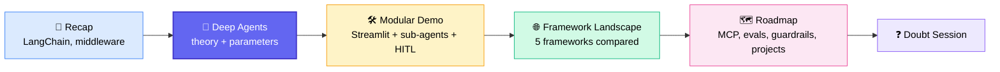
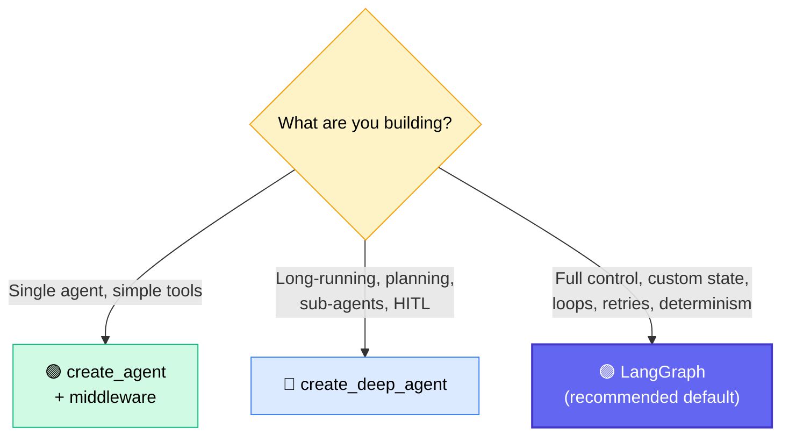
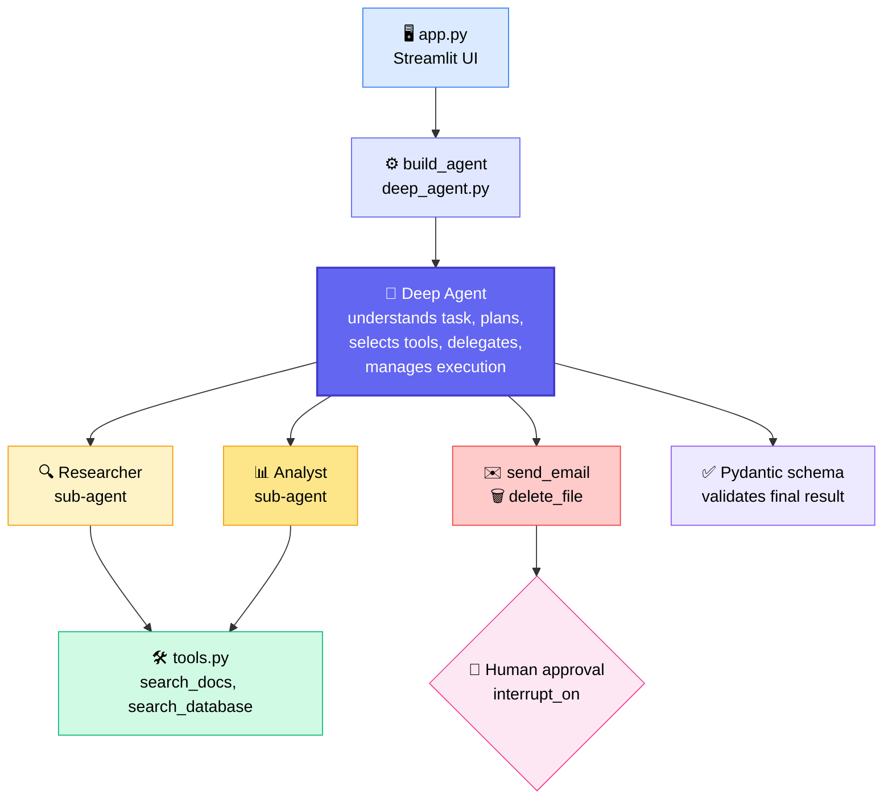
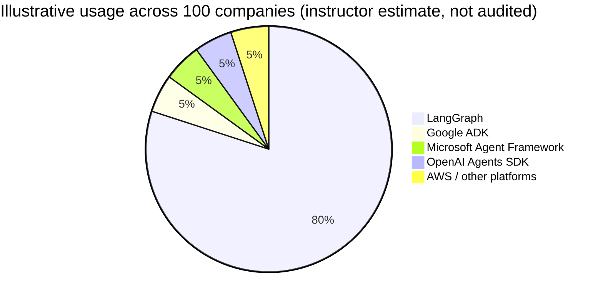
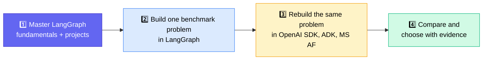
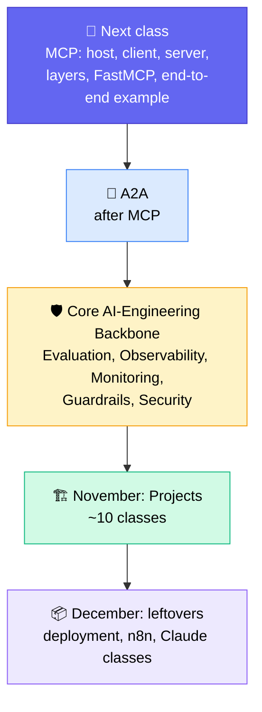

# 🧠 Deep Agents & the Agentic Framework Landscape
### 📋 Lecture Notes — GenAI & Agentic AI Batch (LangChain → Deep Agents → Framework Comparison)

**🎙️ Speaker:** Sunny Savita
**⏱️ Duration:** ~3 hrs (incl. ~20-min break) | **🎯 Session Type:** Live Class + Doubt Session
**📚 Previous class:** LangChain (latest version, middleware, `create_agent`) | **➡️ Next class:** MCP

---

## 🧭 Session Agenda

Sunny wrapped up the LangChain block, taught the **Deep Agents** library with a modular demo project, then gave a tour of the **wider agentic framework ecosystem**. He closed with the roadmap for the rest of the batch.



---

## 🧩 Three Ways to Build Agents in the LangChain Ecosystem

| | 🟢 `create_agent` | 🔵 Deep Agents | 🟣 LangGraph |
|---|---|---|---|
| **What it is** | Function in **LangChain** | **Separate library** (`deepagents`) built by the LangChain team, open source | Orchestration framework |
| **Best for** | **Simple, single** ReAct-style agent | **Complex, long-running, multi-agent** work with planning | **Everything**, built from scratch |
| **Customization** | Model, tools, system prompt, middleware, response format, state/context schema, checkpointer | All of the left **plus** sub-agents, skills, memory, backend, permissions, `interrupt_on`, store | Fully customizable: simple agents, complex agents, deterministic workflows |
| **Core function** | `create_agent(...)` | `create_deep_agent(...)` | State, nodes, edges |

> 💡 **Rule of thumb from Q&A:** "Deep" means a *complex* agent that can do many things. In LangGraph terms, `create_agent` is the simple ReAct agent. Deep Agent is closer to the **supervisor / hierarchical** agents built earlier.



---

## ⚙️ `create_deep_agent` — Parameters Explained

Install the library (add it to `requirements.txt`) and import with `from deepagents import create_deep_agent`.

| Parameter | 💬 Plain-English meaning |
|---|---|
| `model` | **Who thinks** |
| `tools` | **What actions** the agent can take |
| `system_prompt` | The agent's **behavior** |
| `middleware` | **Execution control**, extra functionality around the agent |
| `subagents` | **Whom to delegate** tasks to (the child agents) |
| `skills` | **Expertise it can load**, written instructions in Markdown files |
| `memory` | Persistent preferences and history (e.g. from an `.md` file or a database) |
| `backend` | Where it works: the file-system or back-end layer (e.g. a root `workspace/` directory) |
| `permissions` | **What is allowed** |
| `interrupt_on` | **Human approval** (Human-in-the-Loop) for chosen tools |
| `response_format` | Shape of the **final answer** (e.g. a Pydantic schema) |
| `state_schema` | Data that changes **during execution** |
| `context_schema` | **Who or what this run belongs to** (e.g. user ID and role) |
| `checkpointer` | How the **current thread** is saved |
| `store` | **Long-term** data saving |
| `debug`, `name`, `cache` | Debugging, a custom agent name, caching |

> ⚠️ **Honest take from the instructor:** In his 3–4 years of GenAI/Agentic work he has **never used `create_deep_agent` in production or a POC**. It's a recent addition (about a year old). It's fine for a POC if it meets business needs, but **LangGraph remains the better, recommended option.** Treat Deep Agents as an *extra concept*, not a must-use.

---

## 🏗️ Demo Project — Deep Agentic System (Modular Code)

A dummy but realistic project, run through a **Streamlit UI** (`streamlit run app.py`). The code is on the course GitHub under *Deep Agentic System*.

### 📁 Project Structure

```text
deep_agentic_system/
├── app.py            # Streamlit UI: chat, upload, buttons, response rendering
├── deep_agent.py     # build_agent(): creates the deep agent (main agentic code)
├── tools.py          # search_docs, search_database, send_email, delete_file
├── setup_data.py     # creates dummy docs + SQLite company.db knowledge base
└── workspace/
    ├── docs/         # deep_agent.txt, langchain.txt, langgraph.txt
    ├── company.db    # SQLite database
    ├── memory/agents.md          # agent preferences (long-term memory)
    └── skills/
        ├── finance/skill.md      # how to do finance analysis
        └── research/skill.md     # how to perform research
```

### 🔄 How the Pieces Fit



### 🔑 Key Design Points
- **Tools = any functionality exposed to the agent.** Write a Python function, decorate it as a tool, done.
- **Sub-agents get their own toolsets.** Toolsets can be completely different from the parent's or overlap with it. The same tool can be given to both the deep agent and a sub-agent.
- **Sub-agent definition** = name, description, system prompt, tools, model (as a dictionary).
- **Skills** = sets of instructions in Markdown (same idea as *Claude Skills*). Any text file works, not just `.md`.
- **Memory** = `agents.md` with preferences such as "explain technical concepts clearly and concisely". It can also come from other sources like a database.
- **Human-in-the-loop** triggers on `send_email` and `delete_file`. The UI shows approve / reject options.
- **Response schema** (Pydantic): research report with *summary, key findings, sources, confidence*.
- **Context schema:** user ID + role.
- **Persistence:** in-memory checkpointer and in-memory store (demo only).

### 🧪 Live Demo Results

| Test | Outcome |
|---|---|
| "Run sample research" | ✅ Worked, pulled from local docs and SQLite, used skills and memory |
| "What is LangGraph?" / "Can you create an agentic system with LangGraph?" | ✅ Worked, though the search area was narrow, so answers were shallow |
| Send an email (subject + body given) | ✅ **HITL fired** → approve → saved to the local `outbox` (no real email API wired) |
| Delete a file in the workspace | ⚠️ Failed: the agent expected a **virtual path** and rejected Windows-style paths |
| Memory across turns | ⚠️ Appeared inconsistent; Sunny said the system needs more work |

> 🎯 **Homework spirit:** Extend this system, add real tools (Tavily, Gmail API), harden the file backend, and make it more accurate.

---

## 🌐 The Agentic Framework Landscape

> 📣 **Core message:** *There is no universally best framework.* Choose based on workflow complexity, control needs, cloud/tool fit, reliability, and measured performance. You can even build an agentic system **without any framework** (Sunny did this recently). Frameworks just provide ready-made pieces.

### 🗂️ Categories (from the "Agentic AI Framework Ecosystem" PDF)

| Category | Examples |
|---|---|
| 🟢 **Open source** | LangChain, LangGraph, Deep Agents, CrewAI, OpenAI Agents SDK, Google ADK, Microsoft Agent Framework, AutoGen, AG2, Semantic Kernel, LlamaIndex, Pydantic AI, Agno, SmolAgents, Strands Agents SDK (AWS), Mastra, BeeAI, CAMEL, MetaGPT, BabyAGI, DSPy |
| 🔴 **Commercial / enterprise (paid)** | OpenAI Agent Builder & Responses API, Claude Agent SDK / Claude Code runtime, Amazon Bedrock Agents & AgentCore, Microsoft Foundry Agent Service, Copilot Studio, Vertex AI Agent Builder |
| 🟡 **Low-code / no-code** | n8n, Dify, Flowise, Langflow |

> ✅ You don't need to learn them all. The list is for *awareness*. **Learn LangGraph deeply, skim 4 others.**

### ⚖️ The Big 5 Compared

| Framework | Design mindset | Reach for it when… |
|---|---|---|
| 🟣 **LangGraph** | State → nodes → edges → next node; routing, checkpointing | You need custom state, loops, retries, interrupts, **max control** |
| 🔵 **OpenAI Agents SDK** | Agent loop, tools, **handoffs**, code-driven orchestration | Lightweight assistants with tools + handoffs (works with third-party models too) |
| 🟢 **Google ADK** | Root agent, sequential / parallel / graph workflow templates | You live in the **Google Cloud** ecosystem |
| 🟠 **Microsoft Agent Framework** | Agents, executors, workflows, approvals, recovery. **Most similar to LangGraph** | **Azure / .NET** shops. It's the successor to **AutoGen + Semantic Kernel** |
| 🔴 **CrewAI** | Agents with roles, tasks, crews, event-driven flows | Role-based collaboration; also supports deterministic workflows |

> 🔑 **Key insight:** All five can build single- and multi-agent systems. The real difference is **how they structure control and collaboration.**

### 📊 Rough Industry Usage (Sunny's Estimate)

Sunny stressed that **no audited global market-share data exists**. This is his experience-based view from community forums and research.



### 🧭 Real-World Stories
- A contact using **Google Cloud** was told to use **Google ADK**, and it was **checked in the interview**.
- A learner in the batch (Aditi) uses **Microsoft Agent Framework** because her company is on Azure.
- Companies on **AWS** may mandate **Bedrock AgentCore**. Don't panic: learn the concept via LangGraph and then use Copilot / Claude Code to implement in the mandated framework.

### 🛣️ Recommended Learning Path



**🧪 The benchmark problem (in the PDF):** *Payment API is down* → Triage agent → Logs agent → Metrics agent → Deployment agent. Implement it in every framework with the **same tools, data, and safety rules**.

### 📐 T-Shaped Skills

```text
 ┌─────────────────────────────────────────┐
 │  BROAD: know every component / framework │   ← horizontal bar
 └────────────────────┬────────────────────┘
                      │
                      │  DEEP: master at least ONE (e.g. LangGraph)
                      │
```

Tech leads and solution architects work this way: a broad picture of every component, plus deep mastery of one area.

### ⚠️ Advice on Choosing & Learning
- **Don't trust YouTube hype.** A video on a framework doesn't mean the industry uses it. Check Reddit, GitHub, community forums, and official docs. Use ChatGPT / Claude for research.
- **Frameworks are "just Pythonic code."** Competition means a new one appears constantly.
- **Reading unfamiliar framework code?** Hand the notebook to **Copilot / Claude / ChatGPT** and ask for a simple explanation.
- **Always validate with a prototype** before committing.

### ❓ Framework FAQ (from the PDF)

| Question | Answer |
|---|---|
| Does only LangGraph support graphs? | **No**, Google ADK and Microsoft Agent Framework work similarly |
| Is OpenAI SDK OpenAI-models-only? | **No**, third-party models work |
| Are Google ADK / Microsoft AF cloud-locked? | **No**, they can be built across clouds |
| Is CrewAI only for multi-agent demos? | **No**, it also supports deterministic and normal agentic workflows |
| Which one is industry #1? | No audited data, but LangGraph per the instructor's experience |

**📓 Material shared:** Notebooks mapping LangGraph concepts (agents, tools, structured output, memory, long-term memory, HITL) to the **OpenAI Agents SDK, Google ADK, Microsoft Agent Framework and CrewAI**, plus a comparison PDF with documentation links.

---

## 🔧 Clarifications — Runnables, LCEL & Middleware

### 🏃 Runnables & LCEL
- **Runnables** are LangChain's core building blocks for chaining components: *Sequence, Parallel, Lambda, Branch, Assign, Message History, Passthrough*.
- **LCEL** (LangChain Expression Language) is a **runnable-based pipeline** that uses operators (such as `|`) to connect prompts, models, and tools.
- **LangGraph** is a **graph-based workflow** where you explicitly define state, nodes, edges, and reducers.
- Under the hood, LangChain and LangGraph are **built on Runnables**, but you won't use them directly in projects, so study the notebook once and move on.

### 🧱 Middleware (simplest explanation)
- **Pre-built classes** that add extra functionality **around an agent**. They run **before and after the model call**.
- Not mandatory. In LangGraph you can write the same logic yourself.

| Middleware | What it does |
|---|---|
| Dynamic prompt injection | Picks which prompt to use at runtime |
| Summarization | Auto-summarizes old history when context grows too large (replaces the custom memory logic written earlier) |
| Human-in-the-loop | Pauses for approval |
| Model call limit / Tool call limit | Caps the number of calls |

---

## 🗺️ Roadmap — What's Coming



- **Why these topics matter:** MCP, evaluation, observability, monitoring, guardrails, and security are the **"backbone of any AI system."** Interviewers ask system-design questions around them, so about **5 classes** go to this block, finishing by October end.
- **Evaluation:** whenever you build an AI system, build a **parallel evaluation system** to measure output accuracy.
- **Gateway:** not mandatory to build. You usually *get* one to access models.
- **November projects:** the **first project is built in full detail**. Projects 2 and 3 cover only the core logic and deployment strategy, since the pipeline repeats (~10 classes).
- **Updated batch** arrives in Feb/March, so there's no schedule pressure.
- **MCP notes:** a handwritten notes PDF and an MCP guide were committed to the GitHub repo. MCP is the *concept*, and **FastMCP is a Python package** for implementing it (not to be confused with FastAPI, which builds APIs).
- **Quick definitions:**
  - **Async programming** is a Python/language concept, not AI-specific.
  - **Harness engineering** is the system around the model (planning, implementation, iteration). A learner summed it up as **Agent = Model + Harness**, and Sunny agreed.
- **Prerequisites for deployment:** a cloud account and basic cloud knowledge. **Docker** is part of the deployments.

---

## ❓ Doubt Session Highlights

| Question (asker) | Answer |
|---|---|
| Interview asked about **KV cache** and hyperparameters. Were they covered? (Srikanth) | Hyperparameters were covered briefly. KV cache is transformer architecture, so see the **Transformer session** for ~99% of it. For advanced, model-specific architecture, self-study. |
| How does deployment work for agentic apps? | Two different things: **model deployment** (your own trained model needs GPU infrastructure) vs **application deployment** (RAG and agentic systems that call OpenAI / Claude APIs are just Python apps deployed like any web app) |
| "How would you handle **10,000 parallel requests**?" | Ask *where* the load goes. **Self-hosted model:** load balancing, queues, rate limiting, GPU scaling. **OpenAI or other API:** the provider handles scaling and you pay the bill. |
| New Azure client: Microsoft Agent Framework vs Foundry, or just LangChain? (Swati) | Understand the problem statement and constraints first. **Always run a POC**, ideally the same problem in 2–3 frameworks, then get stakeholder review before committing. Clients won't name a framework, so you decide as the AI engineer. |
| What is **middleware** and how does it relate to LCEL? (Shweta) | See the clarifications above. Middleware = extra functionality before/after model calls. LCEL = runnable pipeline; LangGraph = explicit state/nodes/edges. |
| Agent vs Deep Agent, and when to use which? (GRM) | By **complexity**: simple ReAct agent → `create_agent`; supervisor/hierarchical/multi-agent with planning → Deep Agent |
| Will the end-to-end project cover RAG or agentic work? (Krish S) | Learn **RAG and agentic both**. Other topics are covered after that. |
| GitHub says "unable to render code block" | A GitHub limitation caused by notebook **outputs**. Download locally, or clear all cell outputs, then push. |
| Will A2A be covered? | Yes, after MCP |

---

## ✅ Action Items for Learners

- [ ] 📥 Pull the latest GitHub changes (Deep Agentic System, framework notebooks, PDFs)
- [ ] 📦 Install the `deepagents` library and run the Streamlit demo (`streamlit run app.py`)
- [ ] 🔧 Extend the demo: add a real search tool (e.g. Tavily), fix the file backend path handling, test memory
- [ ] 📓 Skim the OpenAI SDK, Google ADK, Microsoft Agent Framework, and CrewAI notebooks (use Copilot / Claude to explain them)
- [ ] 🧪 Build the **"Payment API down"** problem in LangGraph first, then in 1–2 other frameworks
- [ ] 📖 Go through the Runnables / LCEL section of the LangChain notebook once
- [ ] 🎓 Revisit the **Transformer session** for KV cache and architecture topics
- [ ] 📝 Prepare for the next class: **MCP** (host, client, server, layers)
- [ ] 💡 Keep **LangGraph** as the main practice framework, with other frameworks as awareness

---

*📝 Notes compiled from the full session transcript — Deep Agents, Framework Comparison & Roadmap (instructor: Sunny Savita). Session date and exact course name were not stated in the transcript.*
